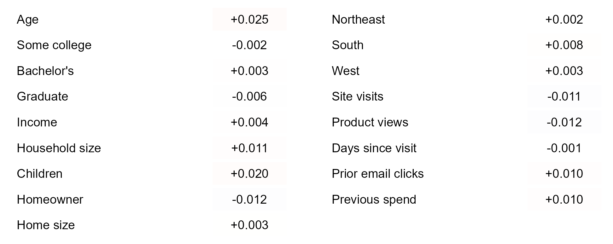
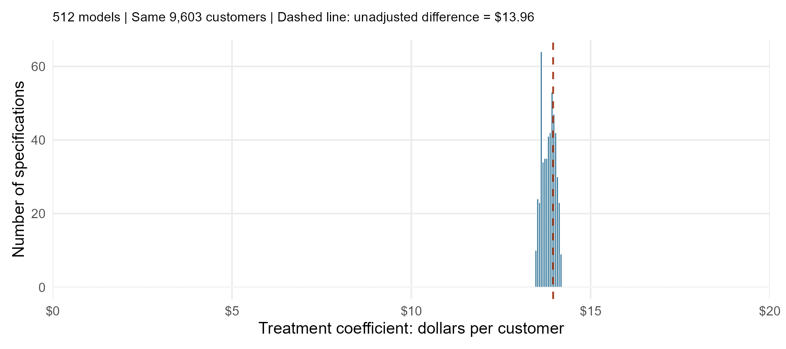
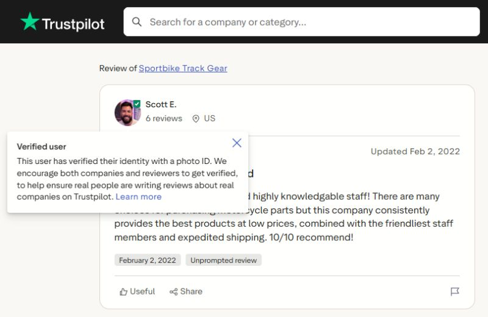
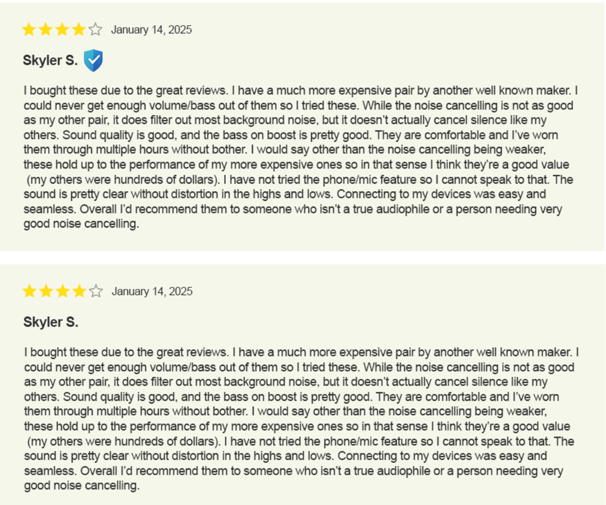
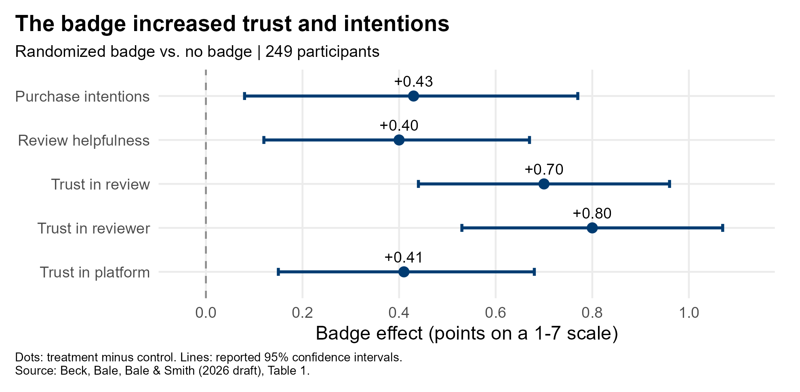
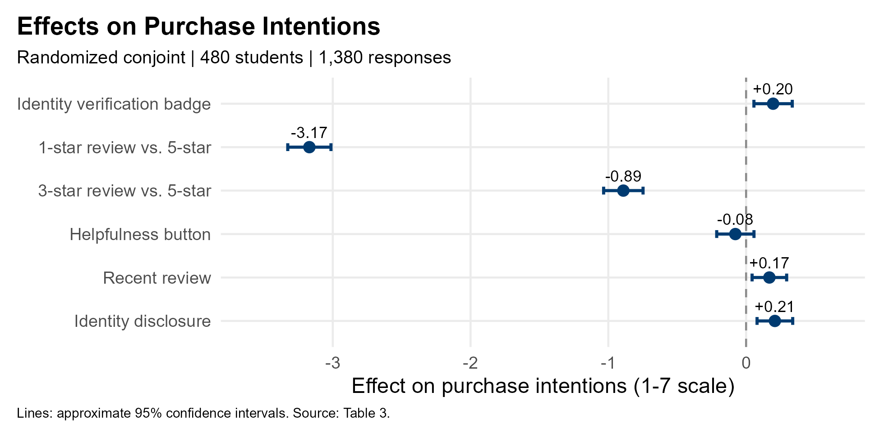
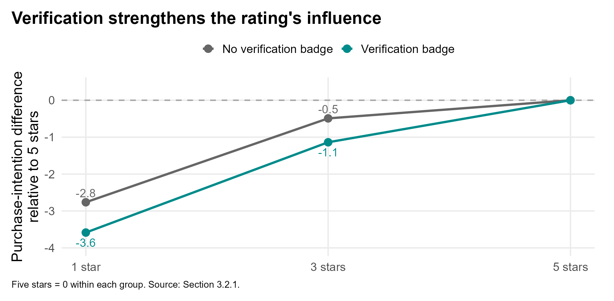
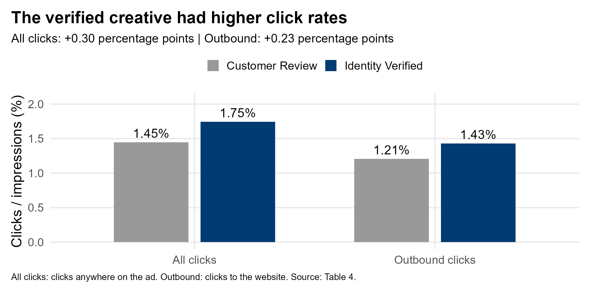
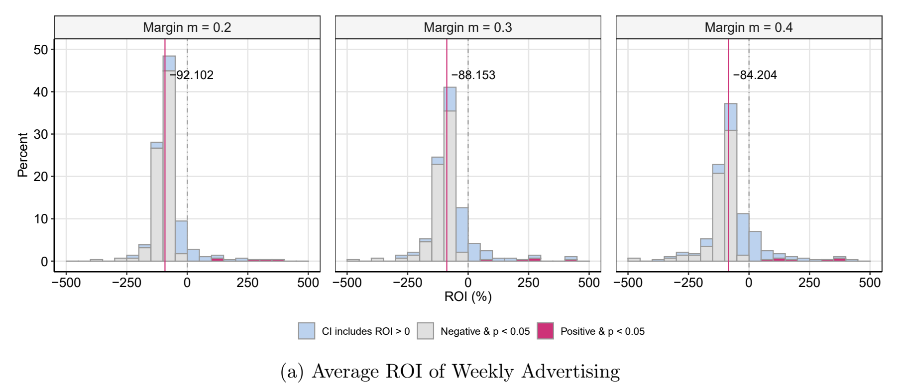

## Extra (Important) Stuff

Two topics today

- Integrity and analytics
- Randomization and Causal Inference

```{r sig-analysis, include=FALSE}
source("analysis/significance-example.R", local = TRUE)
sig_example <- run_significance_example("home_goods_customers.csv")
```

## Integrity in Analytics

<center>

</center>

## The Result Management Wants

The home-goods retailer's management believes **homeowners will spend more during the email campaign**: they have more space to furnish and have spent more at the retailer in the past.

> "We expect homeownership to matter. Can you verify that in your analysis?"

- Outcome: **`CampaignSpend`**, dollars spent in the 30 days after assignment.
- Focus: **`Homeowner`**, comparing owners with nonowners.
- Both models include **`Treatment`** and only customer information available before the campaign.

## Two Defensible Models {.smaller}

**Model A: account for household characteristics.**

```r
CampaignSpend ~ Treatment + Homeowner + IncomeThousands +
  HouseholdSize + HomeSizeHundreds + Age
```

**Model B: also account for the customer's spending history.**

```r
CampaignSpend ~ Treatment + Homeowner + IncomeThousands +
  HouseholdSize + HomeSizeHundreds + Age + PreviousSpend
```

`IncomeThousands` = income / 1,000; `HomeSizeHundreds` = square feet / 100.
`PreviousSpend` covers the **12 months before** treatment assignment.

Both models are estimated on the same underlying data.

**Without seeing results, which one do you expect to be the better model? Why?**

## Does Homeownership "Matter"?

```{r sig-homeowner-intervals, echo=FALSE, message=FALSE, fig.width=11, fig.height=5.2, out.width='100%', fig.align='center'}
library(ggplot2)
sig_intervals <- function(fit, model) {
  estimates <- coef(fit)
  intervals <- confint(fit)
  keep <- names(estimates) != "(Intercept)"
  data.frame(model = model, term = names(estimates)[keep],
             estimate = unname(estimates[keep]),
             conf_low = intervals[keep, 1], conf_high = intervals[keep, 2])
}
sig_plot_data <- rbind(
  sig_intervals(sig_example$model_a, "Model A"),
  sig_intervals(sig_example$model_b, "Model B")
)
sig_terms <- c("Homeowner", "Treatment", "IncomeThousands", "HouseholdSize",
               "HomeSizeHundreds", "Age", "PreviousSpend")
sig_labels <- c("Homeowner", "Treatment", "Income ($1,000)", "Household size",
                "Home size (100 sq ft)", "Age (years)", "Previous spend ($1)")
sig_plot_data$term <- factor(sig_plot_data$term, levels = rev(sig_terms))
sig_plot_data$focus <- as.character(sig_plot_data$term) == "Homeowner"
sig_interval_plot <- ggplot(sig_plot_data, aes(x = estimate, y = term)) +
  geom_vline(xintercept = 0, color = "red", linewidth = .65) +
  geom_errorbar(aes(xmin = conf_low, xmax = conf_high, color = focus),
                orientation = "y", width = .14, linewidth = .9) +
  geom_point(aes(color = focus), size = 2.8) +
  facet_wrap(~model, nrow = 1) +
  scale_color_manual(values = c("FALSE" = "#666666", "TRUE" = "#176A96"),
                     guide = "none") +
  scale_y_discrete(limits = rev(sig_terms), labels = rev(sig_labels), drop = FALSE) +
  scale_x_continuous(breaks = seq(-5, 20, 5)) +
  labs(x = "Coefficient estimate and 95% confidence interval ($)", y = NULL) +
  theme_minimal(base_size = 16) +
  theme(panel.grid.minor = element_blank(),
        panel.grid.major.y = element_blank(),
        strip.text = element_text(size = 19, face = "bold"),
        panel.spacing.x = grid::unit(3, "lines"),
        panel.border = element_rect(color = "#B8B8B8", fill = NA, linewidth = .6),
        plot.margin = margin(8, 12, 8, 8))
sig_interval_plot
```

## Does Homeownership "Matter"?

```{r sig-homeowner-highlight, echo=FALSE, fig.width=11, fig.height=5.2, out.width='100%', fig.align='center'}
sig_highlight_plot <- ggplotGrob(sig_interval_plot)
sig_panels <- sig_highlight_plot$layout[
  grepl("^panel-", sig_highlight_plot$layout$name), ]
sig_panels <- sig_panels[order(sig_panels$l), ]
sig_left_axis <- sig_highlight_plot$layout[
  grepl("^axis-l", sig_highlight_plot$layout$name), ]
sig_y_range <- ggplot_build(sig_interval_plot)$layout$panel_params[[1]]$y.range
sig_homeowner_y <- (match("Homeowner", levels(sig_plot_data$term)) -
                     sig_y_range[1]) / diff(sig_y_range)
sig_highlight_plot <- gtable::gtable_add_grob(
  sig_highlight_plot,
  grid::rectGrob(x = .5, y = sig_homeowner_y, width = .99,
                 height = .85 / diff(sig_y_range),
                 gp = grid::gpar(col = "red", fill = NA, lwd = 2)),
  t = sig_panels$t[1], l = min(sig_left_axis$l),
  b = sig_panels$b[1], r = max(sig_panels$r), clip = "off"
)
sig_highlight_plot <- gtable::gtable_add_grob(
  sig_highlight_plot,
  grid::textGrob("What Happened?", y = sig_homeowner_y - .70 / diff(sig_y_range),
                 gp = grid::gpar(col = "red", fontsize = 13, fontface = "bold")),
  t = sig_panels$t[1], l = sig_panels$r[1] + 1,
  b = sig_panels$b[1], r = sig_panels$l[2] - 1, clip = "off"
)
grid::grid.newpage()
grid::grid.draw(sig_highlight_plot)
```

## Interpreting the Two Models

- **Model A:** homeowners spend about **$6.56 more**, holding its other variables fixed; statistically significant at 5%.
- **Model B:** with prior spending also held fixed, the estimate is **-$0.51** and is not statistically significant at 5%.

Model B tests whether there is an association between home ownership and spending *after* accounting for spending history.

## What Should You Tell Management?

Management would prefer Model A: its significant result supports the story they expected.

**Which model should you choose, and why? What should you ultimately report to management?**

## Don't be a Cuttlefish!

<center>
{width=720px}
</center>

## Have Integrity

"People can behave like cuttlefish, changing their clothing, language, behavior, and thoughts, depending on their surroundings. They might do this in order to impress or be accepted by others. However, this behavior does people more harm than good. In their eagerness to blend in, they can sacrifice their integrity."

[Barbara A. Lewis](https://www.churchofjesuschrist.org/study/ensign/2018/04/integrity?lang=eng)

## Pressure, Decisions, and Consequences

| Case | Pressure and decision | Consequence |
|---|---|---|
| Wells Fargo cross-selling fraud | Meet sales goals; employees opened millions of unauthorized accounts. | [Wells Fargo agrees to pay $3 billion in settlement](https://www.justice.gov/archives/opa/pr/wells-fargo-agrees-pay-3-billion-resolve-criminal-and-civil-investigations-sales-practices). |
| Purdue Pharma opioid scandal | Sell prescription drugs; aggressive marketing downplayed addictive risks and encouraged over-prescription. | [Criminal guilty pleas, $8 billion settlement, dissolution and repurposing for public benefit](https://www.justice.gov/archives/opa/pr/justice-department-announces-global-resolution-criminal-and-civil-investigations-opioid). |

<br>

What pressures could tempt an analyst to tell the story management wants to hear?

## What Should You Do?

- Conduct analyses **in pursuit of truth**, not in pursuit of a specific result.
- Be transparent about analytical decisions and motivations. Don't hunt for statistical significance.
- Be honest about uncertainty and possible omitted influences.

## Randomization and Causal Inference

<center>

</center>

## Topic 2

**Randomization and Causal Inference**

## Review: Omitted Variable Bias

An omitted variable $Z$ can bias a coefficient when:

1. $Z$ is associated with the **outcome**, holding the included variables fixed.
2. $Z$ is correlated with an **included X variable** (after accounting for the other included variables).

In lecture 08, households with more people tended to have more children (household size is correlated with household composition). Not accounting for the number of children changed the coefficient on household size.

## But What If We Randomized X?

Suppose we could randomly assign the values of our X variable of interest.

For example: suppose we could **randomly assign** how many children live in a customer's household.

- Would there be omitted customer characteristics that are related to the **outcome**?
- Would any of those omitted characteristics be correlated with the **number of children**?

## Treatment Was Randomly Assigned

The home-goods retailer randomly assigned customers to receive or not receive the campaign email.

- **Treatment = 1:** assigned the campaign email.
- **Treatment = 0:** assigned no campaign email.
- **CampaignSpend:** spending during the following 30 days.

**What does random assignment imply about omitted variable bias in the coefficient on Treatment?**

## Randomization Breaks the Confounding Link

**Random assignment makes Treatment independent of pre-campaign customer characteristics by design, including characteristics we did not measure.**

For a pre-campaign characteristic $Z$:

$$\operatorname{Cor}(\text{Treatment}, Z) = 0 \quad \text{in the random assignment process}$$

Those characteristics may predict spending. They do not systematically determine who receives treatment.

<!-- Conceptual references: Hernan and Robins, Causal Inference: What If, chapter 2,
https://www.hsph.harvard.edu/miguel-hernan/wp-content/uploads/sites/1268/2024/04/hernanrobins_WhatIf_26apr24.pdf
Chance imbalance: Morgan and Rubin, https://arxiv.org/abs/1207.5625 -->

## Treatment and other $X$ Variables | Correlations

For a treatment that is randomly assigned, what should its correlation be with the other $X$ variables in our data?

## Treatment and other $X$ Variables | Correlations {.smaller}

The **Treatment column** of the correlation matrix, split into two blocks:

<center>
{width=850px}
</center>

All correlations are close to zero: largest absolute value **0.025**.

## Treatment Effect Robustness

When omitted variable bias is an issue, adding an omitted variable can change the coefficient estimates of our model.

Since omitted variable bias **is not** an issue for our `Treatment`, what should happen to the coefficient on `Treatment` when we change the variables that are included in the model?

## Compare 512 Regression Specifications {.smaller}

Estimate $512$ models for `CampaignSpend` as a function of different sets of $X$ variables.

| Group | Variables included together |
|---|---|
| Demographics | Age, Education |
| Income | HouseholdIncome |
| Household composition | HouseholdSize, ChildrenAtHome |
| Housing | Homeowner, HomeSizeSqFt |
| Region | Region |
| Website activity | SiteVisits30d, ProductViews30d |
| Recency | DaysSinceLastVisit |
| Prior email engagement | EmailEngagement90d |
| Historical spending | PreviousSpend |

## The Treatment Estimate Is Consistent {.smaller}

<center>
{width=850px}
</center>

Across **512 specifications**: **$13.48–$14.20** more spending per assigned customer; median **$13.84**.

This is variation across model choices on the **same data**, not a confidence interval or a sampling distribution.

## What Makes This a Causal Comparison?

- Random assignment ensures that treatment and control groups are comparable on **observable** and **unobservable** characteristics.
- The difference in outcome *between* the treatment and control groups is attributable to the **difference in treatment**.

Note that the coefficient estimates the effect of **assignment to the campaign email**, not opening it. Why?

<!-- Research section: supplied October 19, 2026 manuscript. -->

## My Research {.smaller}

**The Effects of Reviewer Identity Verification on Digital Marketplaces**

Ben B. Beck, **Cameron Bale**, Morgan Bale, and Maggie Smith — Brigham Young University

<div style="display:flex;justify-content:center;gap:90px;text-align:center;margin-top:25px;">
<div><p>Ben Beck</p></div>
<div><p>Morgan Bale</p></div>
</div>

Working paper, October 2026. Portraits: [BYU Marriott directory](https://marriott.byu.edu/directory/).

## Reviewer Identity Verification {.smaller}

<center>

</center>

[Source: Trustpilot review](https://www.trustpilot.com/reviews/61faac72a16c1e751f7c5e62) · Screenshot captured October 19, 2026.

<!-- Actual browser screenshot, cropped to retain Trustpilot branding, the review,
identity badge, and its open explanation. No review content or badge was altered.
Identity-verification documentation: https://www.trustpilot.com/blog/trends-in-trust/verified-users -->

## Why Study Identity Verification?

Reviews help us decide what to buy. But can we trust the person behind them?

- Fake and AI-generated reviews make that harder.
- An identity badge tells us the platform verified the reviewer.

Verifying someone's identity does not guarantee an honest review.

**Does that badge change what consumers believe—and what they do?**

## Three Studies

1. **Proof-of-Concept:** Does adding verification to a review change trust and purchase intentions?
2. **Conjoint:** How does verification work alongside ratings and other review details?
3. **Advertising Study:** Does verification increase clicks "in the wild"?

## Study 1: Badge Presence {.smaller}

<center>

</center>

Random assignment: **126 badge / 123 no badge**. Same product, review, and rating. Source: Figure 1.

## Study 1 | The Results

<center>

</center>

## Study 1 | Why Randomization Matters

- We randomly assigned people to see the review **with or without the badge**.
- That makes the groups comparable, on average—even in skepticism or shopping experience we did not measure.
- The difference in their responses is attributable to the **effect of the badge**.

## Study 2: Conjoint! {.smaller}

Students saw restaurant reviews with randomly assigned features:

| Feature | Options |
|---|---|
| Verification | Badge / no badge |
| Reviewer identity | Name and photo / pseudonym |
| Helpfulness button | Present / absent |
| Review age | Two weeks / two years |
| Rating | 1 / 3 / 5 stars, with matching review text |

**A conjoint varies several features so we can estimate the effect of each.**

## Study 2 | The Main Effects

<center>

</center>

## Study 2 | Why Are These Coefficients Causal?

**We randomized every review feature.**

- A person's preferences and characteristics did not determine which features they saw.
- The value of each feature was determined **independently** of the values of the other features in each scenario.

## Study 2 | Verification Strengthens A Reviewer's Message

<center>

</center>

## Study 2 | Verification Strengthens A Reviewer's Message

The **interaction** tells us that verification changes how much the rating matters.

- A one-star review lowers purchase intentions more when verified: **3.6 points versus 2.8**, relative to five stars.
- Verification also reduces skepticism toward very positive reviews.

**A more credible review can make praise more persuasive—and criticism more damaging.**

## Study 3 | Really Right Stuff

<div style="float:right;width:430px;margin:0 0 12px 28px;text-align:center;">

<p style="font-size:15px;margin:6px 0;"><a href="https://reallyrightstuff.com/about-us/">Photo: Really Right Stuff</a></p>
</div>

Our previous studies established an effect from reviewer verification badges in controlled environments. We wanted to test them "in the wild".

We partnered with **Really Right Stuff**, which makes camera and optics support equipment.

Goal: test whether reviewer verification could be leveraged to increase ad engagement.

## Study 3: Creatives

<center>
<div style="display:flex;justify-content:space-between;width:820px;margin:0 auto 8px;font-size:24px;font-weight:bold;">
<div style="flex:0 0 44%;text-align:center;">Campaign 1</div>
<div style="flex:0 0 44%;text-align:center;">Campaign 2</div>
</div>

</center>

## Study 3 | The Divergent Delivery Problem

Meta chooses **who actually sees each ad**.

Even with the same target audience, two ads can reach different kinds of people. This is called **divergent delivery**.

If we observe a difference in click rates between the ads, we don't know if it's due to differences in **creative content** or the **audiences** who saw each creative.

[Burtch et al. (2025), with Brett Gordon](https://arxiv.org/abs/2508.21251).

## Study 3 Campaign Design

Remember how randomization makes the underlying treatment and control groups comparable? We apply a similar idea here.

For each campaign:

- The **same audience, budget, timing, placement, and optimization settings**.
- Similar numbers of impressions per person.
- A check that the people reached had similar ages.

Matching as many campaign characteristics as possible *should* lead to similar audiences for each creative.

[Burtch et al. (2025)](https://arxiv.org/abs/2508.21251).

## Study 3: Results

<center>

</center>

Unobserved audience differences could contribute to the difference.

Verification, combined with algorithmic delivery and similar audiences, increased click rates.

## Your Job

Throughout your career you will make many decisions regarding ads, emails, promotions, prices, website designs, *etc.*

Don't **assume** that you are moving things in the right direction!

## Does Spending More Mean Selling More?

**Lodish et al. (1995), Journal of Marketing Research**

- Studied **389 TV advertising experiments**.
- Raising ad budgets relative to competitors **did not** generally increase sales!

[How T.V. Advertising Works](https://doi.org/10.1177/002224379503200201).

## Paid Search | The eBay Experiment

**Blake, Nosko & Tadelis (2015), Econometrica**

- Ads on eBay's own name had **no measurable short-term benefit**.
- Other search ads helped new and infrequent customers, but had little effect on frequent buyers.
- Average short-term returns were negative.

[Consumer Heterogeneity and Paid Search Effectiveness](https://doi.org/10.3982/ECTA12423).

## TV Advertising: Is the Next Dollar Worth It? {.smaller}

**Shapiro, Hitsch & Tuchman (2021), Econometrica** | 288 brands

<center>

</center>

**More than 80% of brands had negative estimated returns on additional advertising.** Dashed line = break-even; solid line = median.

<p style="font-size:16px;margin-top:10px;">Source: <a href="https://doi.org/10.3982/ECTA17674">TV Advertising Effectiveness and Profitability</a>, Figure 4(a), <a href="https://economics.sas.upenn.edu/system/files/2021-02/Ad-Effects-Generalizable-Robust-Revision-3-Jan-29.pdf#page=22">January 2021 manuscript</a>. Previously circulated as <em>Generalizable and Robust TV Advertising Effects</em>.</p>

## Your Job

Throughout your career you will make many decisions regarding ads, emails, promotions, prices, website designs, *etc.*

Don't **assume** that you are moving things in the right direction!

## Your Job: Find Out Whether It Works

1. Decide what success means: **sales, profit, engagement, retention, etc.**
2. Ask what would happen **without your decision**.
3. Collect data to **analyze** your decision.
4. Use randomization when possible to measure the difference.
5. Analyze with integrity! Compare the benefit with the cost—and be willing to change course.

**Seek the truth, even if it gives you a result you hadn't hoped for.**

## Spiritual Thought


